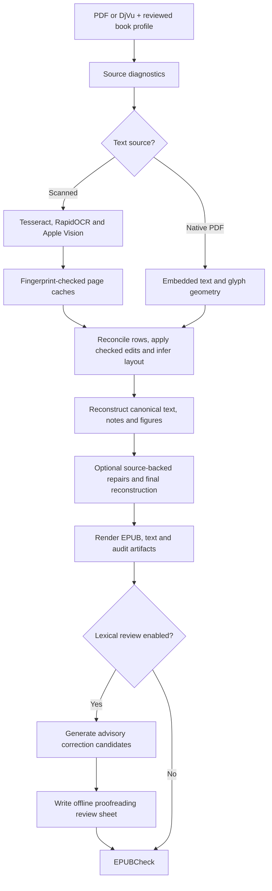
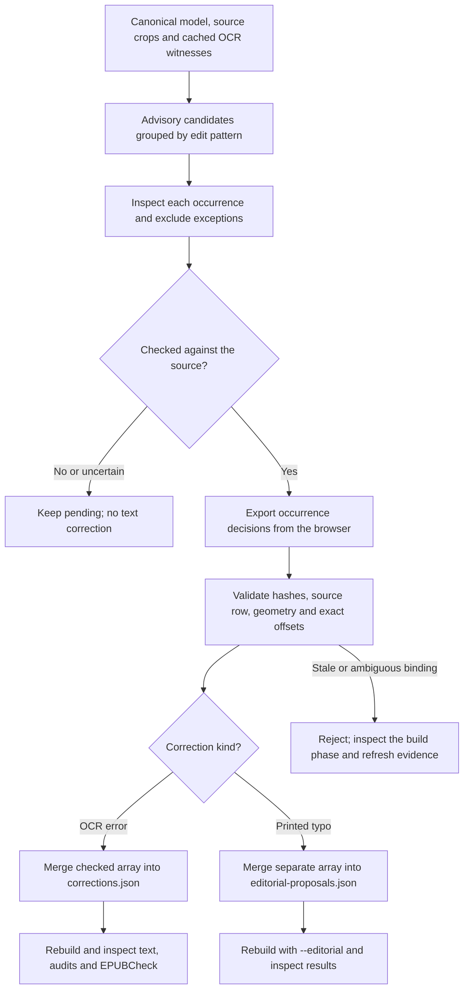

# Docomotive

A local-first research pipeline for converting scanned DjVu files and scanned or native-text PDFs into reflowable EPUBs with figures, quotations, linked notes, metadata and reviewable corrections. Source-specific facts live in profiles; detection, reconstruction and rendering fixes belong in shared code. Conversion is reproducible from pinned tools and cached evidence, but automated recognition and sampled review do not establish complete proofreading.

See [docs/research.md](docs/research.md) for per-book findings, conversion recipes, measurements, artifacts and experiments.

## Pipeline overview

`scripts/pipeline.py` coordinates source diagnostics, extraction, building,
correction proposals, the offline review sheet and EPUBCheck. `scripts/build.py`
performs reconciliation, layout analysis, reconstruction and rendering from
cached OCR or native PDF text. Book profiles select source-specific facts and
optional repair rules; each accepted repair retains its source evidence.



For DjVu, the source adapter first creates a cached raster PDF shared by OCR,
figures and review crops. Native extraction is PDF-only. `--skip-extraction`
reuses complete compatible OCR caches; `--skip-lexical` skips candidate generation
and the proofreading sheet, while profile-enabled repairs inside the build
still run. The coordinator stops when a stage fails.

The EPUB is built **before** advisory candidates and review decisions are
produced. Accepting a browser proposal does not change the book: export checked
corrections, merge them into the profile and rebuild.

- [Setup and usage](#setup-and-usage)
- [Stages and artifacts](#stages-and-artifacts)
- [Profiles and source evidence](#profiles-and-source-evidence)
- [Whole-book proofreading](#whole-book-proofreading)
- [Regression checks](#regression-checks)
- [Reproducibility and limits](#reproducibility-and-limits)
- [Classical correction research and papers](docs/classical-ocr-correction.md)
- [Adaptive profiling and review-efficiency research](docs/adaptive-ocr-profiling.md)
- [Prioritized OCR improvements and simple-method evaluation](docs/ocr-improvement-plan.md)
- [Production review-rule evaluation and local timing](docs/production-review-evaluation.md)
- [Experimental source-bound book feedback](docs/review-feedback.md)

## Setup and usage

Run commands from the repository root. Python 3.14 is the tested interpreter.
Create `.venv` if it is absent, then use it without activation. Fresh multi-engine
OCR requires macOS, Swift/Xcode command-line tools and Apple Vision; Java is
required for EPUBCheck.

```sh
python3.14 -m venv .venv
.venv/bin/python -m pip install . --group dev
brew install tesseract ocrmypdf djvulibre
.venv/bin/python scripts/bootstrap.py

# Use a source-matched, reviewed profile; see Profiles and source evidence.
.venv/bin/python scripts/pipeline.py /path/to/book.pdf \
  --profile config/my-book/book.json \
  --work work/my-book --output output/my-book

# Replay complete extraction caches; apply separately reviewed editorial repairs.
.venv/bin/python scripts/pipeline.py /path/to/book.pdf \
  --profile config/my-book/book.json --work work/my-book \
  --output output/my-book/reading-edition --skip-extraction --editorial

.venv/bin/black --check scripts tests
.venv/bin/python -m unittest discover -s tests
```

Full multi-engine extraction currently requires macOS for Apple Vision and Swift/Xcode command-line tools. Tesseract and RapidOCR run locally on CPU. Cached JSON can be built elsewhere; fresh cross-platform OCR has not been validated. Java is needed for EPUBCheck. Vision may need execution outside the agent sandbox to contact the local macOS service; it does not upload pages.

Runtime packages are pinned in `pyproject.toml`. Dependencies include PyMuPDF, Pillow, lxml, NumPy/SciPy, RapidOCR/ONNX Runtime, Spylls, SymSpell, wordfreq and Requests. Optional extras are `visual` (WeasyPrint rendering), `research` (the locally patched doc-page-extractor), and `kenlm` (an unevaluated scoring adapter requiring a separate language model). `requirements-research.lock.txt` pins the Python 3.14 core, visual, extractor and development environment; it is an environment snapshot rather than a cross-platform lockfile. The scripts run from this checkout; installation supplies dependencies.

For the experimental extractor, build its Python 3.14-compatible wheel before installing the research extra:

```sh
.venv/bin/python scripts/build_doc_page_extractor.py
.venv/bin/pip install '.[research,visual]' --group dev \
  --find-links work/dependency-compat/dist
```

The builder tests the exact upstream source revision and records patch/build/wheel hashes. Its patch adds the tested Python 3.14 package range and a CI matrix; it does not bypass Python compatibility checks. Legacy pdf-craft 0.2.1 requires a different extractor API and older NumPy/Pillow, so it runs in a separate Python 3.12 environment using `requirements-pdf-craft.lock.txt`. See [dependency compatibility](docs/dependency-compatibility.md) for installation and validation details.

Bootstrap downloads checksum-verified PP-OCRv4 ONNX models, a Hunspell dictionary pair and EPUBCheck 5.4.0. OCRmyPDF, pdf-craft, Marker, Docling, LanguageTool and Morfologik have differing experiment/integration status; the [research report](docs/research.md) distinguishes tested tools from planned work.

Keep `work/`: its OCR/model/metadata caches preserve the evidence needed for replay. Generated books and OCR caches are ignored by Git.

## DjVu input

Pass `.djvu` or `.djv` files to the same pipeline, extraction, build and review commands. DjVuLibre (`ddjvu` and `djvused` on `PATH`) renders a full-resolution raster PDF once into `work/sources/`. The adapter checks page count, preserves page dimensions and uses lossless PDF compression; subsequent stages share that rendering. Profiles and review decisions keep the original DjVu file's SHA-256 and one-based source page numbers. OCR provenance records decoder and adapter hashes plus the rendered PDF hash; changed rendering requires fresh OCR. Existing PDF caches are unaffected.

DjVu hidden text, bookmarks and embedded metadata are not imported. Use the scanned OCR workflow; `text_source: "native"` is PDF-only. The cached raster includes the visible DjVu layers, so figures and review crops use the same pixels as OCR.

```sh
.venv/bin/python scripts/source_diagnostics.py \
  "input/F. David Peat - Synchronicity_ The Bridge Between Matter and Mind-Bantam Books (1987).djvu" \
  --output work/synchronicity/source-analysis.json

# After creating and reviewing a matching book profile:
.venv/bin/python scripts/pipeline.py /path/to/book.djvu \
  --profile config/my-book/book.json \
  --work work/my-book --output output/my-book
```

## Russian and multilingual scans

`language: "ru"` selects Russian Tesseract, Apple Vision `ru-RU`, Cyrillic RapidOCR recognition, Russian Hunspell and wordfreq priors, and Russian EPUB navigation. English profiles retain their defaults. Install the additional checksum-pinned resources with `.venv/bin/python scripts/bootstrap.py --language ru`; `--verify-only` checks them without network access. The Russian resource set includes best and fast Russian Tesseract models, a fast English model for mixed citations, a Cyrillic recognition model and the LibreOffice Russian dictionary pair. Language-specific resources remain local; extraction records actual model hashes.

Profiles can select a local `ocr_tessdata_dir`, override engine languages, and declare `ocr_tesseract_page_languages` for source-reviewed mixed-script pages. Such overrides are fingerprinted; unchanged page observations may be reused only when source, rendering, runtime, language and used-model evidence agree. Adding an unused OCR language model does not invalidate another language's extraction cache. Russian spelling proposals are advisory: historical spellings, names and indigenous transliterations need source review. Optional Russian whole-book context and crop repair is described under proofreading below.

`figure_proposals.py` and `note_zones.py` provide suggestion-only helpers for illustration groups, short footer separators, smaller footer type and bibliographic markers. Tight scan margins are permitted for separator proposals; underlines and printer signatures still require source review. They do not silently alter a book profile. Review proposals against the source, especially narrow tool shafts, captions and wrapped prose. Contained crops of dominant upright page scans retain native pixels even when the PDF has surrounding white margins; visible text overlays still require rendered crops. Source-reviewed `source_gaps` insert an explicit notice and prevent paragraph continuation across missing leaves; these notices are excluded from OCR vocabulary statistics.

## Regression checks

```sh
# Rebuild every declared source/reading edition case from cached/native text.
.venv/bin/python scripts/regression.py
# Select a case for a focused check.
.venv/bin/python scripts/regression.py --book organism
# Accept only after every changed artifact is explained against the source.
.venv/bin/python scripts/regression.py --book organism --accept-baseline
```

Cases are declared in `tests/book-cases.json`; compact baselines live in `tests/baselines/books.json`. Source PDFs, profiles, covers and complete extraction caches must be available locally. Builds go into unique directories under `work/regression/`, with per-case logs and a JSON report naming changed artifacts. Comparisons cover canonical models, corrected rows, text, coverage, apparatus, note/backlink counts, figure inventory, EPUB members and package hashes. Volatile build reports are excluded. Missing inputs or failed builds fail the check; a failed batch never updates baselines. Baseline acceptance is explicit and must accompany review of the intended changes. This is a reproducibility/content-regression check, not a whole-book OCR accuracy measurement or EPUBCheck run.

A `changed` result reports a difference, not an improvement. Run regression on a
tree containing only the change under review. For each changed case, build the
baseline commit in a separate `git worktree` using the same `work/` caches; do not
assume an existing `output/` directory represents that commit. Compare the full
outputs, diff text word by word, trace changes to correction audits and check the
source page crops. Explain any lost coverage, notes, backlinks or figures, and
confirm that narrowing a rule only removes edits and widening it only adds them.
Record the reasoning in `docs/research.md` or the commit message before accepting
a baseline. See [AGENTS.md](AGENTS.md) for the full review procedure.

Profiles reject unknown keys, missing required fields, incorrect basic types, invalid normalized geometry and invalid page/chapter references. PDF bounds are checked when the source is opened. Cache preflight validates readable page JSON, page identity, dimensions, text rows, bounding boxes and confidences before reconstruction. A cache is selected only after every page passes; partial experiments retain the previous pointer. JSON and pointer writes use unique atomic staging files. Scanned-note caches include the actual Tesseract English traineddata checksum; changing that model reruns note recognition without invalidating full-page OCR caches.

## Local binarization experiments

```sh
.venv/bin/python scripts/binarization_experiment.py
# Supply another annotated crop set without changing the production pipeline.
.venv/bin/python scripts/binarization_experiment.py \
  --manifest tests/binarization-cases.json --output work/binarization-experiment
```

This offline benchmark compares the current note-crop path, fixed thresholds, Otsu and two Sauvola window sizes using NumPy/SciPy and local Tesseract. Its source-checksummed manifest records marker boxes, adjacent prose controls and fixed short-line height hints. Original crops and deterministic synthetic fading are scored separately. Detection, expected digits among raw OCR alternatives, oracle-box recognition and extra numeric regions are separate measures; none represents accepted note placement or complete proofreading.

`report.json` records tool/model/code fingerprints and raw observations; `review.html` displays each input and thresholded crop. Cached observations allow repeatable comparisons. Production recognition, chapter sequencing and acceptance remain unchanged. The default manifest is a small one-book research sample; see the [measured results and limitations](docs/research.md#note-crop-binarization-experiment).

## Stages and artifacts

| Stage | Tools and behavior | Evidence |
|---|---|---|
| Diagnose the source | Deterministic page sampling; original scan versus composed PDF pixel comparison | `source-analysis.json` |
| Recognize | 300-dpi Tesseract, Apple Vision and Paddle PP-OCRv4 through RapidOCR; native PDF extraction when configured | Per-page JSON and engine/model/source fingerprints |
| Reconcile | Geometry alignment, conservative witness agreement, checked correction overlays | `corrected-pages.json`, `ocr-comparison.json`, `corrections-applied.json` |
| Infer margins | Header/footer recurrence, OCR variant clustering, median/MAD, parity and page-number consensus | `layout-analysis.json` |
| Reconstruct | Canonical paragraphs, notes, verse and figures; source-linked spans and lexical line joins | `book-model.json`, `text-coverage.json` |
| Analyze the whole book | Chapter TF-IDF, spelling recurrence and page/chapter spread; reference/index evidence separated | `vocabulary-analysis.json`, `protected-term-proposals.json` |
| Render | Deterministic EPUB ZIP and XHTML/internal-link checks | EPUB, text, `report.json`, `preview/` |
| Propose corrections | Hunspell via Spylls, SymSpell, word frequency, witnessed book vocabulary and anchored OCR disagreements; optional scoring adapters | `correction-candidates.json` |
| Review | Offline scan crops, witnesses, text contexts and optional bounded Jev proposals | `proofreading-review.html`, `note-review.html`, JSON evidence |
| Validate the EPUB | EPUBCheck runs after the optional candidate/review-sheet stages | `epubcheck.json` |

For a profile with `slug: "my-book"`, the main deliverables in the selected
output directory are:

| Artifact | Use |
|---|---|
| `my-book.epub`, `my-book.txt` | Reading output; editorial EPUBs use `my-book-corrected.epub`, while the text keeps the base slug in its separate output directory |
| `book-model.json`, `corrected-pages.json` | Canonical source-linked structure and corrected row evidence |
| `report.json`, `text-coverage.json`, `corrections-applied.json` | Build summary, retained-source coverage and correction audit |
| `correction-candidates.json`, `proofreading-review.html` | Advisory queue and scan-backed occurrence review, unless `--skip-lexical` |
| `epubcheck.json` | External EPUB validation results from the coordinator |
| `preview/` | XHTML and image assets for inspection |

Optional rules write additional reports such as `lexical-repair.json` and
`word-spacing-repair.json`. Keep the matching `work/` caches as well as the
profile: output artifacts alone cannot replay recognition evidence.

The primary OCR engine is profile-selected. Embedded text can be another witness; it is not assumed correct. Multiple modes of one engine are correlated observations, and even independent engines can agree on a mistake. Empty queues mean detected items were handled, not that the book is error-free.

## Profiles and source evidence

Create a profile directory with `book.json`, `corrections.json`, `review-decisions.json`, `protected-words.txt`, `copyright.xhtml` and `editorial-proposals.json`. Optional files hold reviewed line-join decisions and frozen metadata enrichment. Start from `config/book.json`, replace its source SHA-256 and all source-specific metadata/layout facts, and use isolated work/output directories. Empty correction and review arrays are valid.

Profiles describe chapter ranges, opening cutoffs, note regions, verse, columns, engine choices, printed pagination, artwork and reviewed exceptions. PDF page numbers are one-based; OCR coordinates are normalized, while publisher-mark crops use PDF points. A profile is reviewed input, not inferred truth. Artwork roles and bounds still need source inspection.

Inspect representative pages and create transcribed evaluation regions before full OCR. Test individual engines with selected `--pages`; inspect chapter openings, notes, columns, quotations and rare terms. Changing the source requires a new profile hash. Exact overlays fail when occurrence preconditions change. OCR corrections and printed-typo editorial changes remain separate editions.

Correction overlays can use `exact_row: true` to match an entire OCR row. This is useful for removing standalone reader annotations without also changing matching punctuation in prose. Bounding boxes record evidence; wording and occurrence counts are the replacement preconditions.

## Layout, typography and note heuristics

Recurring margin text is clustered conservatively, with robust positions, parity and page-number consensus. Statistical recurrence is supporting evidence rather than a calibrated probability that text is a header.

Scanned prose uses deterministic Theil–Sen left/right margin envelopes to compensate for skew. Sustained symmetric insets support quotations; occasional deeper first lines remain paragraph indents. Unstable, sparse, hanging and native-text layouts retain conservative fallback paths. Margin models, source rows and fallback reasons are audited.

Short, shallow OCR boxes can exaggerate apparent whitespace and split a final word into its own paragraph. With at least eight local prose pitches, reconstruction can retain an unindented short continuation after a full line when center spacing stays within 30% of the median. Real gaps, explicit starts, verse, hanging entries and native text remain separate. A leading OCR asterisk becomes an opening quote only when both fresh comparison engines read that quote and agree on the complete remaining line (allowing straight/curly double-quote variants); embedded OCR alone cannot authorize it. Both repairs record source geometry and evidence in the audit.

`recover_scan_font_metrics` aligns hidden PDF text with fresh OCR and transfers glyph sizes only. Smaller source-backed quote measurements yield relative EPUB font sizes; hidden OCR font names do not establish the original family. `recover_pdf_typography` separately transfers inline styles where text and geometry agree. Both require usable source evidence. Verse detection preserves short ragged runs and stanza gaps while avoiding ordinary wrapped prose.

`recover_pdf_numeric_superscripts` optionally transfers one-to-three-digit superscripts from an aligned PDF text layer. The digit must carry a raised source flag, measure at most 80% of nearby prose size and sit at least 18% of that size above its baseline. Matching complete digits retain their text. An ambiguous symbol or short glyph run can be corrected only between substantial matching text anchors, with the source digit corroborated by tight local 600-dpi Tesseract crops. A half-point padding retry reduces interference from neighboring quotes; competing numeric readings prevent repair. Cached readings bind pixels, helper code, Tesseract version and traineddata, and PyMuPDF version. Segmentation modes are correlated evidence. Repeated identical digits, partial numeric matches and rows without prose support remain unchanged. This mode avoids importing noisy word-level styles from hidden OCR and does not create bibliography links. Chapter-grouped numbered bibliographies can use the existing `endnote_chapter` and `endnote_sections` profile facts: the shared linker validates each section's numbering, links recovered superscripts by chapter and number, and adds exact backlinks. With `endnote_reference_mode: "chapter"`, unrecovered markers retain chapter-level navigation; a chapter-end shortcut appears only where the linker actually uses fallback backlinks. Chapters with complete inline links have no extra shortcut. Stable chapter-start anchors remain available for note return links; the report counts fallbacks separately from inline links.

`research_missing_endnotes` adds a local whole-book research pass after existing superscript recovery. It requires chapter-scoped `endnote_sections`. Known markers bound each missing number's search by page, row and character offset; it assumes increasing chapter-local numbering. Existing anchors common to every longest nondecreasing sequence bound the search; conflicting anchors are quarantined and reported without rewriting their source text. Tinted scan pixels are normalized with 1% histogram-tail clipping before shared connected-component, robust baseline and raised-glyph detection at 400 dpi. Unwhitelisted Tesseract glyph/line crops establish the digit and its placement; tight single-character retries help narrow serif 1s. At least two consistent crop reads and one unique placement are required. Segmentation modes remain correlated evidence, and sequence never supplies an unobserved digit. Existing punctuation is preserved, known links cannot be reused, and detached OCR digits are absorbed only after verified inline recovery. Cached Apple Vision and PP-OCR rows can corroborate the same word gap, with original grayscale glyph retries resolving threshold-induced 3/8 and 5/1 confusions. A title citation before a parenthetical continuation additionally needs fresh pixel-based placement. A quote token is replaced by a digit only with raw glyph and independent-engine agreement; repeated asterisk readings reject false numeric competitors. Observation caches bind source hash, input rows, extraction helpers, OCR/traineddata and image-library versions. `missing-endnote-research.json` records searches/readings; `missing-endnote-review.html` exposes unresolved ranges and candidate source crops. The research selector uses the shared `MarkerEvidence` representation also consumed by the initial scanned-note selector. It aligns actual observations across each chapter with deterministic dynamic programming, allows missing labels and false detections, and checks competing assignments by excluding each proposed marker. Scores are relative heuristics, not probabilities: two agreeing reads score 6, one scores 3, and consecutive labels add 2. Automatic research edits require consistent source reads and a margin of at least 3 over alternatives; sequence cannot rescue contradictory pixels. One glyph cannot supply multiple labels, overlapping edits/crops cannot coexist, and positive symbol evidence is kept as a rejection reason. Whole-path protection quarantines connected groups of duplicated glyph crops when their text positions disagree, including nonadjacent reuse. Contradictory readings cannot contribute sequence scores or adjacency bonuses; an unresolved numeric competitor blocks automatic acceptance of that label. Consistent repeated raw readings of a different digit override normalized consensus, while mixed noisy retries do not. Geometry edges are cached across exclusion checks. Raw/normalized evidence, quarantined anchors, alignment scores and margins are recorded in JSON and the review HTML. Extraction cache fingerprints exclude selection rules so policy experiments reuse pixel evidence. The pass defaults off, so existing profiles retain their behavior.

`infer_inset_verse` optionally preserves colon-introduced runs of at least four aligned inset lines with ragged widths, including lowercase chants whose OCR has no font metadata. It rejects ordinary wrapped prose and keeps source line breaks. `recover_scan_inline_italics` optionally uses source-pixel stem lean and local character OCR to restore complete italic word groups. Nearby prose supplies a skew reference; every word needs independent support and uncertain alignment abstains. Scans are decoded once per page, glyph projections are batched, and contiguous stem consensus filters fresh character OCR. Cached positive and negative results bind source, eligible rows, helpers and OCR/runtime versions; cover or metadata changes do not invalidate them. This heuristic does not recover exact font families or guarantee complete italic coverage.

`link_symbol_footnotes` optionally connects a unique printed `*`, `†` or `‡` to its footnote on the same original page, with a backlink to the exact marker. Source offsets keep paragraphs crossing pages unambiguous. A missing space after the note's leading symbol is accepted. A duplicated `°*` OCR prefix is collapsed only when two aligned witnesses agree on a single literal symbol. Multiple symbols in a page-group note, missing or duplicated body markers, and unrecognized note prefixes stay on page-group fallback links and appear in the apparatus report.

`recover_pdf_heading_styles` optionally restores aligned headings supported by bold evidence on every source glyph. `recover_hanging_margins` optionally applies the same stable Theil–Sen left-edge estimator to hanging references/index columns, preserving entry boundaries on skewed scans. It uses no quote inference and falls back when the column lacks sufficient stable evidence. Both flags default off for existing profiles.

For scanned pages, `recover_image_only_headings` recognizes short margin-aligned labels with a prose neighbor and extra preceding spacing, including scans carrying an old hidden OCR layer. It uses center-to-center line pitch because OCR boxes can overlap, and rejects sentence tails, sparse pages and reference sections. The additional opt-in `recover_centered_headings` admits fully italic centered labels and centered bold-title/italic-subtitle pairs, with local width and line-pitch controls; centering alone is insufficient. Aligned typography transfer can match letter-spaced source headings by exact compact text agreement when at least three isolated letters establish tracking; it does not replace wording. Isolated right-aligned parenthesized credits after a closing quote become attributions, including on sparse epigraph leaves. These passes infer roles and alignment, not original font families or italics. `source_prose_indents` renders the first-line indentation already measured during reconstruction, including flush-left prose after headings. These options default off.

`recover_opening_epigraphs` is an opt-in scan pass for a narrow, inset opening quotation followed by an entirely italic credit and separated broad prose. It requires smaller OCR glyph boxes and aligned source-font measurements, uses local body width/pitch, and rejects mid-body passages, missing credits, separated paragraphs and sparse pages. A detected run keeps its first-line indent without splitting its wrapped lines; its measured relative type size is retained. Text and source row boundaries remain unchanged.

`recover_index_digits` is an opt-in scan reconciliation rule restricted to `index_pages`. It repairs short mixed digit/letter references such as `I60` to `160` only when two fresh aligned engines agree on the complete token sequence, with unchanged words anchoring the row. Only serif `I/l` versus `1` and `O` versus `0` substitutions qualify. Pure Roman folios, different numeric readings, changed words and disagreements abstain; each accepted edit retains both witness lines in the audit. Selecting a different primary engine for an entire index should be checked for new digit errors, not judged merely by the number of clickable links.

`infer_verse` defaults to true. Set it to false when a book's verse ranges have been checked explicitly; the configured ranges still apply, while inference cannot pull a nearby prose tail into the poem.

`recover_ocr_glyph_confusions` optionally accepts a common alphabetic word when all three OCR witnesses agree and the primary differs by one confusable digit (`0/o`, `1/i/l/t`, `5/s`, `8/b`). Length is limited to 2–10 characters and word frequency must reach Zipf 4. Dates, formulas and arbitrary alphanumeric replacements remain outside this rule. Agreement still requires source review when handwritten notes can contaminate every witness.

`recover_scanned_endnotes` detects raised glyphs at 400 dpi, estimates prose baselines and recognizes isolated crops locally. Character boxes anchor replacements without losing neighboring punctuation. A chapter-wide increasing sequence resets at each chapter, permits missing references, rewards consecutive numbers and rejects ambiguous assignments. Ties and order conflicts trigger tight-crop retries with single-character segmentation, multiple scales and resampling variants. Adjacent broken raised components are included before trimming the complete marker. Common glyph confusions such as 6/8 receive a smaller relative penalty than unrelated substitutions. Scores are documented heuristics, not calibrated probabilities; sequence alone does not supply unread digits. Subscripts, ordinary numbers and mathematical notation have geometric/punctuation guards.

Recognition evidence and retries are cached by source, OCR/tool versions, algorithm and geometry. Sequence-score changes reuse crop evidence. Unlocated or unresolved references retain chapter-level endnote navigation and remain visible in `scanned-endnote-analysis.json`.

`recover_variable_superscripts` optionally admits narrower serif digits and raised glyphs up to 76% of normal cap height. Its 400-dpi crops reconnect two-pixel vertical ink breaks at a fixed threshold and expand top clearance on short tails. Recognition-only English Paddle PP-OCRv4 supplies additional tight-crop readings at two padding sizes, filtered at model score 0.75; these are correlated observations, not independent probabilities. Model checksums and runtime versions enter the cache fingerprint. Chapter/title regions are excluded before sequencing. Detached numeric OCR fragments are excluded only when their pixels overlap an already recovered marker, with an audit showing where that digit is represented.

`recover_reference_markers` reads missing or damaged numbered entry starts from source line crops at a page-specific hanging margin. Text agreement and the existing section counter must corroborate a freshly observed number; letter-like readings need an additional digit crop. It restores observed geometry and preserves the strict complete reference-sequence check. Both recovery options default off for older profiles. Explicit `page_labels` should replace a constant offset when the scan omits numbered leaves.

The marker search extends beyond OCR's right edge because tiny trailing references and quotes may be absent from its text box. Short lines borrow an estimated letter height from up to three nearby long lines in the same column, while retaining their own measured baseline. This avoids treating a raised digit as body text when only two or three ordinary letters are present. The final OCR crop remains tight around the detected marker.

Raised regions with no valid initial numeric reading get a tight single-character retry before being discarded: digits such as 9 and 11 may initially appear as letters or punctuation. Only numbers actually read from the crop enter sequence selection. Wider search clearance is trimmed before whole-line recognition, so extra whitespace does not disturb existing character placement.

Marker placement can use a four-digit historical year as an anchor. Unpunctuated citations after capitalized names require matched surrounding prose and a gap containing no prose letters. If whole-line OCR merges a numeral into punctuation, a fallback masks the observed glyph, recognizes the remaining prose and reinserts only the crop-read number at its measured position. Tall overlapping crops receive a bounded contrast pass; chapter sequence still rejects unsupported readings.

Chapter-opening cutoffs are checked against source-row geometry before assembly. If a broad, continuous prose run crosses the configured title boundary, its matching preceding lines are retained. The pass requires at least four body reference lines and consistent column, width, left margin, glyph height and line pitch; headings and separated epigraphs stop the walk. Sparse pages and native publisher PDFs retain their configured boundaries. Inferred cutoffs live only in build state, so profiles remain unchanged; assembly, lexical context and coverage use the same effective boundary. `chapter-body-boundary` entries in `corrections-applied.json` record every recovered row and the supporting measurements.

Optional `recover_scan_italics` recovers whole-line emphasis inside existing verse regions from local scan pixels. Connected glyphs are tested against a bounded shear grid; at least eight usable glyphs and two upright prose control lines are required. A strong majority must agree on rightward lean and improved vertical-stem concentration. Mixed fonts, short credits, low contrast and uncertain page skew abstain. This does not recover inline italic words, identify publisher font families, or infer italics merely because text is a quotation. Accepted and rejected measurements appear as `scan-italic-evidence` in `corrections-applied.json`. Hidden OCR font flags remain insufficient evidence for scan typography.

Figure extraction prefers the original raster when its transform and overlays are verified; otherwise it renders the PDF crop. Captions normally remain reflowable; reviewed source crops can retain captions or notation as facsimiles when text recovery is unreliable. These portions do not adapt like prose and need descriptive alt text. `source_relative_figures` preserves reviewed artwork proportions. `recover_ocr_regions` replaces garbled rows where fresh engines agree on separate lines and geometry avoids duplication. An existing matching neighbor is retained once. A single extra digit-confusion token in one fresh engine requires exact lexical corroboration from embedded OCR; substitutions of prose words remain rejected.

Optional `figure_cleanup: "white"` normalizes scanned paper with local NumPy/Pillow processing. A robust, coarse lighting field whitens sparse diagrams without binarizing gray strokes. Dense artwork receives margin cleanup around an estimated protected photo rectangle; narrow margins can use a simpler one-dimensional field. Strongly colored, dark, tiny or uncertain crops receive no pixel cleanup. Low-contrast dense regions are treated conservatively as potential photographs. This assumes exposed, light, approximately neutral paper; it is not semantic background removal.

Cleanup operates directly on cropped source pixels, then encodes JPEG once at quality 98 for line art or 95 for dense artwork, with optimized progressive coding and full chroma resolution for RGB assets. Original pixel crops and normalized lossless PNG masters are kept outside the EPUB in `figure-cleanup/`; `index.html` compares originals and final JPEGs and links to the masters. The JSON evidence records source/master/export hashes, paper estimates, protected bounds and codec settings. PNG masters preserve exact protected photo pixels, while final JPEGs introduce measured compression differences. `figure_color_mode` controls cleaned-figure export: `auto` selects grayscale only for neutral pixels (maximum channel spread two levels), `rgb` retains color, and `grayscale` records a reviewed monochrome source fact. Tinted scans remain RGB under automatic detection; grayscale export removes tint and stores luminance only, while RGB masters remain available for audit. Defaults retain existing JPEG assets and encoding behavior. Covers and other full-page artwork are not included in this opt-in figure stage; transparency is not currently exported.

Run `scripts/verify_figure_cleanup.py OUTPUT --profile PROFILE` to check decoded master/export pixels and packaged assets. An optional `--baseline PRE_CLEANUP_OUTPUT` also verifies unchanged text, notes, canonical structure and non-image package content; add `--editorial` for the corrected edition. Its local ink-contrast diagnostic uses SciPy smoothing to avoid confusing bright scan noise with faint ink, and reports JPEG error separately. It complements full-resolution image review and EPUBCheck rather than proving every original detail is preserved.

Native-text extraction masks reviewed diagram labels before horizontal merging. Positioned bold headings may contain unstyled separator spaces without losing their heading role. Optional `native_heading_merge` joins tightly wrapped heading lines with matching font sizes; `native_list_layout` preserves measured multi-span markers and hanging continuations as separate flowing items; `native_relative_font_sizes` retains relative sizes for smaller examples/quotations; `native_index_indents` preserves child-entry indentation. These options default off for existing profiles. Single-span list markers and cross-page list continuations remain conservative. Source markers currently render as hanging paragraphs rather than semantic nested lists. Mirrored references/index pages may need different reviewed gutter splits on odd and even pages.

Coauthors with contributor role `aut` are emitted as EPUB creators and shown on the title page. A checksum-verified local cover takes precedence over an approved downloaded reference image, preserving its resolution.

Builds also write `performance.json`, which is excluded from deterministic book comparisons. It reports total and named-stage times (nested times overlap), scoped Tesseract calls, and observation/retry/resource cache hits and misses. OCR/render counters cover the shared scanned-note primitive and marker resources; they do not claim to measure full-page extraction, other OCR backends, or review/figure rendering.

PDF numeric-superscript attachment extracts text and spans together once per page, excluding raster images from that extraction. It checks span geometry only for matched lines containing candidate numeric superscripts. Text agreement, raised/smaller glyph checks and crop corroboration remain required; this reduces repeated work without relaxing evidence thresholds. Native text extraction also accepts already-extracted text data for reuse, while retaining its existing default behavior.

Retry placements—including successful empty results—are cached separately from glyph readings. Keys bind source PDF/page, complete glyph readings/box, row text/box, OCR/traineddata, Python/image-library versions and placement/render helper semantics. Failed OCR is not cached. Per-build reuse keeps at most two full-page grayscale images, 128 pixel-and-option-keyed line OCR results and eight engine-page row sets. Mutable results are copied so callers cannot alter later evidence. Runtime telemetry wrappers preserve helper introspection; changing detection semantics still invalidates the relevant caches.

## Whole-book proofreading

Optional `repair_ocr_word_spacing: true` splits unknown fused words when two
cached OCR engines and fresh line crops at two scales agree on the same literal,
anchored spacing. Known/protected words and capitalization are guarded; conflicts
remain review-only in `word-spacing-repair.json`. See
[within-line spacing research](docs/word-spacing.md) for the rule, evaluation and
limits of broader split/join proposals.

[Classical OCR correction research](docs/classical-ocr-correction.md) reviews
weighted edits, corpus ranking, finite-state methods and multi-engine agreement,
with archived papers and a reproducible cross-book evaluation. These experiments
generate review proposals and do not expand automatic correction.

Vocabulary analysis runs after complete paragraph and note assembly, using the same canonical text as EPUB rendering. Chapters are IDF documents; notes contribute to their source chapters, while references/index remain separate. General-language Zipf frequency is an approximate background prior. High IDF alone cannot protect a token: OCR mistakes can also be rare. Recurrence, spread and competing spellings propose review priorities, without automatically extending the protected dictionary.

The optional `repair_lexical_confusions: true` pass ranks unknown prose words after the whole book is assembled. For English it combines SymSpell's bundled unigram/bigram corpus, a smoothed bigram Markov model adapted to the book, and common scanned-glyph confusions. Russian uses wordfreq unigrams, dictionary-accepted inflected forms observed in the assembled book, and the same smoothed book-bigram Markov model with unigram backoff. Russian one-edit candidates (including missing letters) and title-case words are eligible only with dictionary acceptance, repeated book evidence, and corroborating source crops; protected vocabulary remains excluded. An automatic target must be common, occur at least twice elsewhere in the assembled prose, and be read identically by local Tesseract on a tight 600-dpi word crop in both single-word segmentation modes. Weak ranking margins additionally require agreement with the embedded PDF OCR. Two modes of one engine are not independent witnesses. Protected names and vocabulary, accepted words, references and indexes are excluded; conflicts remain review-only. Ranking scores are heuristic evidence, not calibrated confidence. For conflicting Cyrillic word crops, the pinned local RapidOCR model can supply two consistent readings at fixed raster scales, each scoring at least 0.90; dictionary, recurrence and context gates still apply. The audit retains the conflicting Tesseract readings and RapidOCR scores. This threshold is an empirical guard, not a calibrated probability. Dictionaries, selected-language traineddata, tool version and crops are fingerprinted; `lexical-repair.json` records accepted and rejected decisions. Cached recognition supports deterministic replay. For image-only PDFs, cached local line OCR supplies character boxes when embedded word boxes are absent; matching neighboring words must still establish the crop. That geometry pass is not an independent textual witness, and weak ranking margins still abstain without embedded corroboration. If neither geometry path is reliable, the repair abstains.

For non-English books, that pass also examines physical line seams in the assembled paragraphs: stray dots/bullets, lost hyphens and mixed Latin/Cyrillic glyphs can obscure a divided word. It ranks the combined spelling, verifies the two original scan fragments separately, and records a zero-space continuation in the canonical model. Local column margins prevent joins across illustrations, columns or paragraph boundaries. Exact protected-vocabulary joins preserve rare terms without licensing guessed spellings. Repeated inflections omitted by Hunspell can enter the candidate vocabulary when the book and language frequencies support them. Short accepted words are only reconsidered at suspicious damaged line endings; conflicting source readings remain for review. Tight fragment crops stop before the next word. Whole-word crop conflicts try three fixed variants at most: ordinary clearance, tight clearance, then unmasked source-line geometry; all competing readings remain in the audit. An unchanged fragment may use stable comparator readings at a lower threshold because no letters are being replaced; changed letters retain the stricter guard.

`link_numeric_footnotes: true` enables bounded recovery of unique trailing calls for numbered page footnotes. Fresh character boxes isolate the current line, connected ink separates digits from closing quotes, and a detached dot rejects exclamation stems. Two local OCR readings must establish the digit. A difficult serif **1** may instead match two OCR-verified examples from different pages of the same book, with a conservative normalized shape-distance threshold; this fallback does not classify other digits. Only a verified superscript on the correct source page links to a unique footer target. Unresolved calls remain listed in `numeric-footnote-analysis.json` with ordinary page-group access.

Numeric footnote recovery can split a merged footer when two cached OCR engines agree on all lexical content and fresh 300/600-dpi crops corroborate each complete line. Observed Latin Roman numerals survive Cyrillic OCR lookalikes. For a short line with an invalid baseline, the retry borrows neighboring source letter height and fits body bottoms within the original row; source-font agreement remains mandatory. Punctuation-gap length excludes whitespace, and comma/dash spacing survives marker insertion. An omitted closing quote additionally needs a cached spelling, two adjacent raised quote strokes, and positive tight-crop readings. These rules do not use a book-specific phrase or coordinate.

`source_figure_anchors: true` places artwork using source rows throughout a reconstructed paragraph, splitting at a safe word boundary and preserving annotation offsets and source ownership. A short smaller-type caption/credit run with an explicit figure/photo cue stays with the illustration instead of joining prose. `quote_font_scale` controls relative quote/verse size (for example, `0.9`). Both layout features are opt-in for existing profiles.


`repair_word_wraps: true` enables a guarded reconstruction repair: an attested split word at the normal prose margin can override a spurious style-based paragraph flag. Real indents, gaps, columns, headings, verse and known hyphenated compounds retain their boundaries. Line joining also recognizes a stray dot after a wrap dash (`уме-.` / `ния`), removing it only at a source-line seam when the joined word is attested; unmatched fragments remain visible for review. Rare joined forms need at least Zipf 1 and a tenfold frequency advantage over the hyphenated form. Both options default off for existing profiles; enable them for a source and review the resulting changes.

Open `OUTPUT/proofreading-review.html` in a browser to compare scan crops, witnesses and context-ranked suggestions and export decisions. When enabled, the sheet also shows already-applied local spelling repairs and their word crops. Remaining proposals need reviewed config overlays for application. Manual/editorial and automatic lexical edits share exact occurrence checks, and every retained source row must map once into the canonical model. Coverage cannot prove that OCR recognized every mark in the scan.

The pipeline now supplies `--work` to `candidates.py`. Three cached engines must
agree at aligned positions for a word to enter the witnessed book vocabulary;
a proposed spelling needs attestations on at least two pages outside the pages
being reviewed. Separately, two non-primary engines can flag an anchored word
or spacing disagreement, including dictionary-valid words. These signals add
review proposals, never automatic corrections or protected vocabulary.

The review sheet groups proposed character/spacing patterns and shows **every
occurrence**, with its own source crop, witnesses, replacement and decision.
Select members individually to exclude exceptions. Batch decisions require an
explicit acknowledgement that every selected crop was checked. Changing a
replacement clears its source acknowledgement. Legacy word-level browser
selections are not copied to individual occurrences.



Convert the exported decisions to exact config overlays with:

```sh
.venv/bin/python scripts/review_edits.py /path/to/book.pdf \
  --profile config/my-book/book.json --book-output output/my-book \
  --input /path/to/proofreading-decisions.json \
  --output output/my-book/reviewed-corrections.json --kind ocr
```

The exporter verifies source/model/profile hashes, row text, geometry and exact
occurrence offsets, rejects unchecked, overlapping or ambiguous edits, and
validates replacements with the build's checked-edit machinery. It preserves
multiple edits in one line by rebasing them in order. Merge the resulting array
after existing `corrections.json` entries, preserving its order; use
`--kind editorial` for a separate `editorial-proposals.json` array. These commands
do not modify profiles or EPUBs. Rebuild and check the source: a row changed by a
later automatic repair can differ at the manual-overlay phase; reconstruction
can also normalize a line differently at the editorial phase. In either case
the build rejects the exact precondition. Do not loosen the anchors to bypass
that rejection. Cross-row or ambiguous mappings remain manual review items.

Scan acknowledgements in `review-decisions.json` are separate from text corrections. New entries bind the source PDF, exact reviewed text and OCR witness/glyph evidence with SHA-256 hashes. Changed evidence returns to review even if geometry matches. Identical evidence can follow a shifted row; repeated identical locations require unique geometric disambiguation. Legacy entries keep their historical effect but are labeled `legacy-geometry-only` and listed in `report.json`, alongside mismatch reasons. They are not silently upgraded.

```sh
.venv/bin/python scripts/review_decisions.py /path/to/book.pdf \
  --profile config/my-book/book.json --input output/my-book \
  --output output/my-book/scan-review.html
```

The offline sheet shows scan crops and witnesses. Choose Reviewed only after checking them, then export selected decisions and merge them into the profile's decision array, replacing the corresponding reviewed legacy entries. Unselected/pending and Uncertain records never acknowledge a row. Decisions acknowledge recognition evidence; corrections still require the separate exact-overlay workflow.

For note-marker review:

```sh
.venv/bin/python scripts/note_review.py /path/to/book.pdf \
  --profile config/my-book/book.json --input output/my-book \
  --output output/my-book/note-review.html
```

The self-contained offline sheet shows unresolved and retried locations, marker close-ups, paragraph context, recognition evidence and missing numbers by chapter.

## Metadata and covers

`scripts/metadata.py` uses free, unauthenticated Open Library ISBN/edition APIs, Crossref for DOI-only sources and reviewed source cover URLs. ISBN check digits and title/author/publisher identity are checked. Records/images are cached with provenance and hashes; `--offline` replays them. `--fetch-metadata` in the coordinator allows cache misses to fetch remotely. The EPUB build itself uses frozen enrichment and does not contact the network.

For older books without a verified ISBN, `openlibrary_edition` accepts an exact edition identifier such as `OL123M`. Its record key, publication date, title, author and publisher must match the profile. This also attempts an edition-specific cover download; a later edition's ISBN or cover is never assigned merely because its title matches. Catalog name comparisons normalize Unicode accents.

ISBN association does not approve a cover. Wrong editions, placeholders, conflicting records and low-resolution images require review. A supplied checked local cover or deterministic typographic cover can be used. Copyright text is reflowed without a copyright-page scan. Unsupported metadata is left absent rather than invented.

## Optional Jev review

`scripts/jev_rank.py` ranks supplied lexical candidates against context. `scripts/jev_notes.py` ranks existing OCR-backed ambiguous citation locations. Both use pinned `jev-1.13.0`, validated Choice responses and content-addressed caches. Jev accepts text rather than images; its confidence cannot establish scan fidelity. Results are review proposals, not automatic book edits.

```sh
.venv/bin/python scripts/jev_rank.py --dry-run --output output/jev-request-preview.json
.venv/bin/python scripts/jev_notes.py --profile config/my-book/book.json \
  --input output/my-book --output output/my-book/jev-note-request-preview.json --dry-run
```

Review and authorize the exact outgoing excerpts before omitting `--dry-run`. Credentials come from `TYPESAFE_API_KEY` or `.env` and are excluded from artifacts. A running-number conflict should first trigger better local crop recognition; semantic ranking cannot recover a digit from an image it cannot see.

## Reproducibility and limits

The coordinator writes `source-analysis.json` before conversion. This deterministic sample diagnostic looks for an upright page scan, dense painted PDF text and substantial additional ink when compared with the same scan rendered at identical placement. It flags possible reconstructed OCR overlays for review; hidden OCR, occluded text and a few genuine captions do not suffice. It is a warning, not permission to discard annotations or a guarantee about unsampled pages. Run it separately with `scripts/source_diagnostics.py PDF --output REPORT.json`.

After checking the original pixels, `scan_raster_only: true` makes fresh OCR, figures and facsimiles use the embedded page scan directly. It fails unless each requested crop has exactly one upright dominant scan covering it. OCR caches fingerprint this mode and the scan extraction helper; changing the mode requires re-extraction. The default preserves rendered PDF content, including genuine overlays. Original scan resolution is retained rather than upscaled into invented detail.

Pinned tools, source/config/code hashes, checksum-verified resources, cached responses, sorted ZIP entries and fixed timestamps support deterministic replay. Fresh OCR across OS/tool versions is not guaranteed byte-identical. EPUBCheck and source-row coverage complement lexical and visual review; neither establishes full proofreading or behavior on every reading device. Missing source pages and uncertain readings are reported rather than reconstructed without evidence.

`repair_ocr_punctuation` checks suspicious isolated dots/bullets, punctuation clusters and incomplete long prose endings after whole-book assembly. Unique lexical anchors map each gap back to its physical row; cached whole-page OCR and fresh local OCR must corroborate the replacement. Tiny residual scan specks have a bounded geometry exception. Superscript spans are excluded, and punctuation is never supplied merely because grammar predicts it. `normalize_quotation_marks` separately normalizes complete pairs to Russian «…» and nested „…“, preserving character counts and annotation offsets. Orphan marks remain review items; a dangling quote cannot affect a later paragraph.

`repair_ocr_case` optionally repairs Cyrillic mixed case and unexpected interior capitalization from matching source readings with neighboring lexical anchors and dictionary acceptance. When whole-page OCR loses a row, two fixed crop scales check its literal reading; these are stability evidence from one engine. Protected names are excluded. A missing stroke can be repaired only within one character edit. Latin brands, acronyms and ordinary proper names retain their case.

`recover_body_top` retains full-width lowercase prose above the global header cutoff when its dimensions agree with several ordinary body lines. Skewed scans can make an enclosing OCR box much taller than the actual font. `inspect_partial_rows` reports primary rows substantially narrower than an aligned OCR witness. It can restore observed horizontal bounds after a source-reviewed full-row transcription; it does not substitute an unverified witness for missing rare names. `recover_figure_frames` uses OpenCV to refine reviewed image crops against visible rectangular ink borders and short smaller captions. A coverage guard prevents selecting one panel of a larger illustration.

These flags default off. `punctuation-review.html` combines punctuation, quote, case, partial-row and numeric-footnote uncertainties, with contexts and links to the PDF pages. Machine decisions remain available in the corresponding JSON reports. `link_numeric_footnotes` checks both interior and trailing raised glyphs; isolated footer readings and matching source-font examples can recover damaged labels. Font matching retains physical size as well as normalized shape, so short quotation strokes cannot become digits simply by resizing them.

`recover_gap_rows` optionally checks gaps of about two measured prose-line advances for a row present in cached OCR but absent from the primary reading. Fresh crop agreement can restore the literal line. For Cyrillic scans, recognition-only PP-OCRv5 can bypass a failed text detector; two fixed scales must agree at the empirical 0.90 score floor, and cached OCR must corroborate the lexical tail. A recovered leading fragment additionally needs a dictionary-supported join with the preceding printed wrap. Shared lexical anchors quarantine rows that might already be represented by a damaged neighboring observation, preventing duplicate text. `row-gap-analysis.json` and the combined review retain unresolved candidates.

`retain_uncertain_gap_rows` is an opt-in completeness safeguard. An isolated missing row can be retained verbatim from cached OCR when two fresh Tesseract crops and an independent recognition-only engine support its full lexical content with at most two character discrepancies. It does not resolve disputed glyphs or count as an accepted correction. Potentially duplicated neighboring rows are excluded. Such rows remain marked in the canonical sources, `row-gap-analysis.json`, and the offline proofreading sheet.

Physical wrap repair tests exact dictionary joins before considering letter changes: a sparse language model can prefer a neighboring inflection even when the source letters are intact. A valid short prefix does not rule out a damaged wrap if the joined form recurs and the suffix is unknown; both physical fragments still need crop evidence. Punctuation comparisons tolerate one damaged neighboring word only with two other exact substantial anchors, and quote/apostrophe lookalikes are folded only in gaps already containing a double quote.

For Cyrillic lexical review, a bounded shortlist of five one-edit common dictionary forms can be checked against whole-page Tesseract and local line OCR at two fixed scales. All three must select the same anchored word; two exact neighbors disambiguate its location. This can recover an infrequent word that the book Markov model ranked below a common alternative, without trusting low-confidence isolated-word readings.

Framed figure refinement can retain a compact side or bottom caption while removing adjacent body text. Small-font geometry identifies caption runs; remaining ink outside the frame must be explained by those captions or prose below the frame. Substantial unexplained artwork keeps the original crop to protect multi-panel figures. If direct contour detection abstains, a seven-pixel morphological closing retries sub-millimeter border breaks in the 200-dpi preview. Original ink still supplies the coverage evidence, and already accepted frames keep their original result.

An isolated numeric footer prefix may lose its serif and narrow to a full-height stem. Its width check can use a bounded exception only in that prefix position, with matching physical height and shape on two independently read source pages; inline glyphs retain the stricter width guard. A line-end wrap dash is kept out of sentence-punctuation insertion and left for span review.

If an ordinary marker strip finds no raised component but primary OCR reports the expected numeric label, a bounded taller strip checks that location. Fresh character boxes must locate the reported mark, and the complete glyph must match independent narrow-strip font samples; adaptive results cannot seed that font bank. Raw glyph OCR caches include padded pixels, page pixels, expected label, recognizer code, language-model data and runtime identity, so changing selection rules can reuse valid observations.

### Building a corrected reading edition

Set `repair_lexical_confusions: true` and `lexical_repair_policy: "corrected-reading"`
in the book profile. The default build applies only corrections whose evidence
shows an OCR error (`ocr-supported` or `ocr-alternative-supported`); printed or
unresolved spellings stay as printed and are reported for review. Build with
`--editorial` for the `-corrected` edition, which also corrects those. Corrected reading editions separate spelling detection,
meaning preservation, and source-origin evidence. Source-printed spelling errors
can be corrected, with every original token and source location retained in the
correction audit.

The local route accepts dictionary-supported, context-ranked candidates when the
source crop agrees in both fixed segmentation modes, or a bounded confusable
character has support in Tesseract's LSTM alternatives. Those alternatives are raw
scores, not calibrated probabilities or independent engine votes. Names require an
attested capitalized phrase and a meaning judgment on every route; protected terms and ordinary accepted vocabulary remain
excluded. Removing a negative prefix cannot use the crop-only route.

Builds only replay cached Jev judgments. Uncached contextual checks remain review
items and do not cause network requests. The judgments ask separately whether the
specific token is a spelling error and whether its replacement preserves intended
meaning. A confirmed, dictionary-invalid one-edit spelling with one admissible
target can be normalized consistently across lowercase prose; names, valid words,
and quotations cannot inherit that rule. The 0.90 judgment thresholds and OCR
alternative floor are empirical guards, not measured guarantees of correctness.

After a local build, prepare a reviewable request manifest:

```sh
.venv/bin/python scripts/jev_spelling.py \
  --input output/synchronicity/lexical-repair.json \
  --cache work/synchronicity/jev-spelling \
  --output work/synchronicity/spelling-requests.json
```

Adding `--run` explicitly sends uncached surrounding paragraphs and token
alternatives to TypeSafe's API using the configured `TYPESAFE_API_KEY`. Rerun the
pipeline to apply the cached judgments. `lexical-repair.json` records the
original and alternative scores, acceptance basis, source-origin signal, and
contextual judgment provenance. The build report records the selected policy and
number of reading-edition spelling corrections. OCR support is not automatically
classified as proof that an error was printed in the original.

Symbol-footnote recovery can replace a confused `®`, `©`, `°` or `º` only when two aligned OCR engines agree on the complete row with a literal asterisk. An isolated damaged footer prefix can instead match source-font templates from two other pages; each template requires two literal OCR witnesses. Physical size and a tight shape-distance limit reject quote strokes and ordinary circles. Notes may begin directly with an opening quotation mark after their symbol. Failed recovery retains page-group navigation rather than placing an inferred link on a prose word. The search also uses localized punctuation disagreement or omission when a single-entry page footnote lacks its body call. At least two independent aligned rows must preserve every lexical anchor; only a disputed gap of at most two punctuation glyphs is considered. Fresh character OCR bounds the scan crop, keeping unchanged punctuation outside it. One component must match physically sized star templates from two other independently verified pages, and only one supported location on the page is accepted. This also covers an unrecognized footer prefix. Disagreement alone never authorizes an edit; letters, ordinary numeric expressions, existing calls and multi-entry groups are protected. Candidate readings, scan coordinates, template matches and abstentions are recorded in `corrections-applied.json`. Numbered references continue to use the separate chapter-sequence and glyph-confusion research described above.

`infer_full_width_quotes` optionally detects smaller quotations without side insets. It requires a colon introduction, visible spacing at both boundaries, at least three stable-margin lines, a completed quoted passage, and reductions in both glyph-box height and line pitch relative to local body controls. The inferred relative font scale is passed to the existing quote renderer. The flag defaults off for earlier profiles.

`reference_regions` limits hanging bibliography layout to source-reviewed vertical regions (`page`, `lo`, `hi`) on mixed pages. Prose outside those regions keeps ordinary paragraph reconstruction and source-line dehyphenation. Whole-page `reference_pages` remains available for actual bibliography pages; non-overlapping regions are validated.

`morphological_word_wraps` optionally adds pinned local pymorphy3/OpenCorpora evidence for Russian physical line-end joins that Hunspell and whole-word frequency miss. Dictionary-known inflections qualify; dictionary-backed `не` + noun/adjective analyses can qualify. Unknown-prefix, suffix and general compound guesses abstain. Corpus-attested hyphenated forms take precedence. Existing joins retain their audit action; additional joins use `remove-morphological`. The report fingerprints the analyzer, dictionary version and dictionary files. This joins printed fragments; it does not propose replacement letters.

`recover_footer_bounds` can retain a first footnote line whose primary OCR box crosses a footer cutoff: a unique independent reading must place the same line inside the footer, and moving the cutoff must not capture an unverified neighbor. `recover_reference_prefixes` restores a dropped short uppercase reference label only when two fresh OCR engines agree on the complete label and unchanged definition. Both are opt-in, geometry constrained, and audited.
